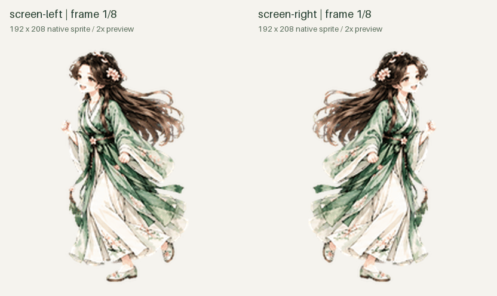

# 《蛊真人》同人桌宠资源

两套根据角色参考图制作的水墨风桌宠资源：**樱慈（普通版）**与**樱慈·Q版**。

## 动画预览与下载

| 普通版 | Q版：待机不眨眼 |
| --- | --- |
|  |  |
| [下载普通版](downloads/normal.zip) | [下载Q版](downloads/chibi-no-blink.zip) |

普通版保留正常人物比例，左右移动使用相互对应的步态。Q版在待机时双眼始终睁开，仅保留轻微呼吸动作。



## 这是什么

这是自定义桌宠的**人物外观与动画资源包**。每套包含：

- `pet.json`：名称、描述及图集路径。
- `spritesheet.webp`：透明无损动画图集。

资源包本身不是插件、技能或独立应用。

## 如何使用

1. 下载上方 ZIP，并解压。
2. 在支持该格式的自定义桌宠环境中使用。导入方式以对应应用提供的功能为准。
3. 如果你的 Codex/ChatGPT 环境已经接入支持自定义桌宠的 Pets 工具，可以把解压后的 `spritesheet.webp` 提供给助手，请它校验图集、创建自定义桌宠，并在需要时启用。

本仓库未提供通用的“一键安装”程序，也不保证所有桌宠软件都兼容。

## 图集规格

- v2 格式，1536 × 2288 像素，8列 × 11行。
- 单帧 192 × 208；共73个有效帧。
- 九种标准动作及十六个视线方向。
- 上方动图用于展示；实际应用播放节奏由对应应用控制。

## 目录

```text
pets/normal/       普通版资源
pets/chibi/        Q版资源
downloads/        可直接下载的 ZIP
previews/         动画预览
SHA256SUMS.txt     文件校验值
```

## 同人说明

根据用户提供的《蛊真人》角色参考制作的非官方同人资源，与原作官方无关。本仓库未为角色或美术资源声明开放许可；使用、转载或改作时请确认相应权限。
